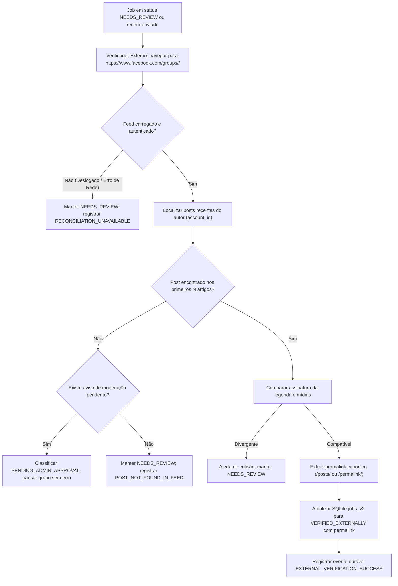

# Proposta Técnica de Conciliação Externa — Fase 10

**Documento:** Especificação de Arquitetura e Engenharia de Verificação Externa  
**Projeto:** Facebook Grupos — Operação Diária Auditável  
**Autores:** Antigravity (Gemini 3.8 Flash) & ChatGPT (Auditor Forense)  
**Status:** Proposta para PR subsequente (Fase 10)  
**Data:** 31 de Outubro de 2026  

---

## 1. Justificativa e Princípio Fundamental

Nas Fases 2 a 9, a automação com Playwright comprovou a segurança local de:
1. Upload de mídia via input nativo e drag-and-drop sem travamento de caixas Win32 `#32770`.
2. Escopo estrito do editor de texto Lexical restrito ao modal do compositor (`[role="dialog"] [contenteditable="true"]`).
3. Bloqueio pré-clique de duplicidade e registro de `SUBMIT_INTENT`.
4. Monitoramento passivo pós-clique (`POST_UI_CLOSED_UNVERIFIED`).

Contudo, **o fechamento do modal do compositor ou a resposta de upload HTTP nunca equivalem a uma publicação real aceita pelo Facebook**. 

Existem quatro desfechos reais possíveis após o clique em "Publicar":
- **Publicado com Sucesso:** O post é renderizado imediatamente no feed do grupo.
- **Pendente de Aprovação (Moderação Ativa):** O post foi retido pelos administradores do grupo com a mensagem: *"Sua publicação foi enviada e está aguardando aprovação de um administrador"*.
- **Silenciosamente Rejeitado / Bloqueado:** O Facebook fecha a janela mas descarta o post por políticas internas, rate limit ou verificação de integridade.
- **Erro de Conexão no Envio:** A requisição caiu durante o upload mas o estado da UI tornou-se incerto.

> [!IMPORTANT]
> **Princípio Zero da Fase 10:**  
> Nenhuma publicação será considerada concluída sem evidência externa verificável no feed do grupo ou captura do permalink canônico. Na ausência de prova conclusiva, a ocorrência permanece em `NEEDS_REVIEW` e **a fila diária é imediatamente pausada**, impedindo qualquer retry automático.

---

## 2. Arquitetura da Verificação Externa

A Fase 10 adicionará o módulo `app/reconciliation.py` e o comando associado `scripts/reconcile_job.py`.



---

## 3. Critérios de Correspondência Criptográfica e Semântica

Para evitar falso-positivos com posts antigos ou de outros membros, a conciliação aplicará uma checagem rigorosa de múltiplos fatores:

1. **Destino Exato (`group_id`):** A navegação deve ser estritamente na URL do grupo onde o disparo foi autorizado (`https://www.facebook.com/groups/<group_id>/`).
2. **Identidade do Autor:** O artigo (`[role="article"]`) deve conter o nome visível do autor correspondente ao perfil ativo autenticado (ex.: `Anderson Marques` para a conta `principal`).
3. **Correspondência da Legenda:**
   - Para não armazenar textos sensíveis em logs, o sistema calcula o hash SHA-256 do texto completo e uma assinatura dos primeiros 40 caracteres normalizados.
   - O texto do artigo no feed deve conter o prefixo normalizado da legenda aprovada na configuração (`daily.json`).
4. **Correspondência de Mídia:**
   - Se o criativo continha 1 foto: o artigo deve conter ao menos uma tag de imagem renderizada (`img`) com atributo `src` válido do CDN do Facebook.
   - Se continha múltiplas fotos: verificar presença de grid/múltiplas miniaturas.
   - Se continha vídeo: verificar tag `video` ou container de player de vídeo.
5. **Janela Temporal de Tolerância:**
   - O timestamp do post (ex.: *"Agora há pouco"*, *"1 min"*, ou atributo `aria-label`/timestamp UTC na tag `abbr`/`a`) deve ser de no máximo 15 minutos em relação ao horário de disparo (`SUBMIT_INTENT`).

---

## 4. Extração do Permalink Canônico Real

Para auditoria forense transparente, a verificação externa deve extrair o URL permanente do post:
- No Facebook Grupos, o permalink reside no link do timestamp da publicação:
  - Seletor típico: `[role="article"] a[aria-label*="hora"], [role="article"] a[aria-label*="minuto"], [role="article"] a[role="link"][href*="/posts/"], [role="article"] a[href*="/permalink/"]`
- O permalink extraído deve ter o padrão:
  - `https://www.facebook.com/groups/<group_id>/posts/<post_id>/` ou
  - `https://www.facebook.com/groups/<group_id>/permalink/<post_id>/`
- O permalink é sanitizado (removendo parâmetros de rastreamento como `?__cft__`, `__tn__`) e gravado no campo `permalink` da tabela `jobs_v2`.

---

## 5. Estados e Tratamento de Exceções

| Estado Detectado | Ação na Fila Diária | Status no SQLite | Notificação Operacional |
| :--- | :--- | :--- | :--- |
| **Post confirmado com permalink** | Desbloqueia próximo slot da agenda | `VERIFIED_EXTERNALLY` | `EXTERNAL_VERIFICATION_SUCCESS` |
| **Aviso de moderação / aprovação pendente** | Pausa o grupo específico por 24h; não bloqueia outros grupos | `PENDING_ADMIN_APPROVAL` | `GROUP_REQUIRES_ADMIN_APPROVAL` |
| **Post não localizado no feed** | Pausa imediatamente toda a agenda diária | `NEEDS_REVIEW` | `RECONCILIATION_POST_NOT_FOUND` |
| **Sessão deslogada durante verificação** | Pausa imediatamente a agenda | `NEEDS_REVIEW` | `RECONCILIATION_AUTH_LOST` |
| **Feed com layout Lexical não reconhecido** | Pausa imediatamente a agenda | `NEEDS_REVIEW` | `RECONCILIATION_DOM_AMBIGUOUS` |

---

## 6. Schema de Persistência no SQLite (`jobs_v2`)

Para a Fase 10, a tabela `jobs_v2` será estendida (de forma não-destrutiva) com:
```sql
ALTER TABLE jobs_v2 ADD COLUMN permalink TEXT;
ALTER TABLE jobs_v2 ADD COLUMN verified_at TEXT;
ALTER TABLE jobs_v2 ADD COLUMN verification_evidence_sha256 TEXT;
```

A evidência bruta de verificação conterá:
- `timestamp_observed_utc`
- `author_name_hash`
- `caption_prefix_hash`
- `media_type_confirmed`
- `permalink`

A chave privada HMAC local continuará sendo usada para pseudonimizar permalinks nos relatórios públicos do GitHub (`reports/forensic/`), exportando apenas a comprovação matemática de que o permalink foi obtido e validado.

---

## 7. Critérios de Aceite para a PR da Fase 10

1. **Zero Auto-Retry:** Em nenhuma hipótese um post não localizado sofrerá reenvio automático.
2. **Fail-Closed em Moderação:** Detecção explícita de grupos com pré-moderação ativada.
3. **Idempotência do Inspector:** O processo de conciliação é estritamente de leitura (read-only no Facebook), não executa cliques de curtir, comentar ou postar.
4. **Resiliência a Layouts Dinâmicos:** Se o Facebook alterar as classes do feed, o verificador deve falhar fechado com código `DOM_RECONCILIATION_AMBIGUOUS` sem corromper a base local.
